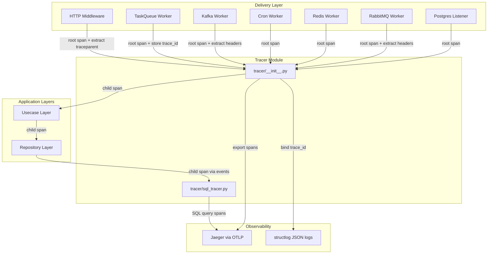
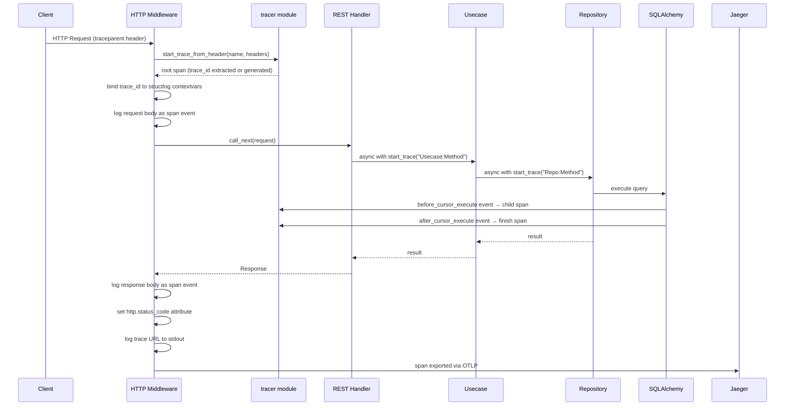
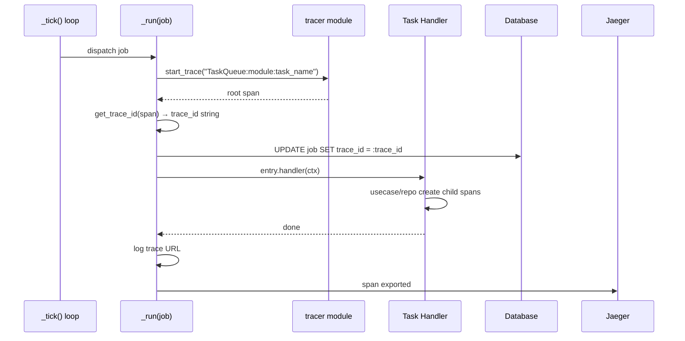

# Design Document: Distributed Tracing

## Overview

End-to-end distributed tracing for merapy, porting the candi (Go) tracing pattern to Python with OpenTelemetry. The design ensures that every HTTP request and every worker job (TaskQueue, Kafka, Cron, Redis, RabbitMQ, Postgres Listener) produces exactly one trace visible in Jaeger by service name. Each trace contains child spans for the delivery → usecase → repository call chain, plus SQL query spans. Application logs are correlated via `trace_id` bound to structlog context vars, and a Jaeger dashboard URL is logged after each request/job completes.

The key difference from Go's explicit `ctx` passing is that Python's OpenTelemetry SDK uses `contextvars` — `start_as_current_span` automatically sets the active span in a ContextVar, and child spans find their parent implicitly. This simplifies the API but requires care with `asyncio.create_task` (which does NOT inherit context vars without explicit `copy_context()`).

## Architecture



## Sequence Diagrams

### HTTP Request Flow



### TaskQueue Worker Flow



## Components and Interfaces

### Component 1: Enhanced Tracer Module (`tracer/__init__.py`)

**Purpose**: Central tracing utilities — span creation, trace ID extraction, header propagation, trace URL generation.

**Interface**:
```python
from contextlib import asynccontextmanager
from typing import AsyncIterator
from opentelemetry import trace


def init_tracer(service: str, *, console_export: bool = False) -> None:
    """Initialize the global TracerProvider. Idempotent."""
    ...

def get_tracer(name: str = "merapy") -> trace.Tracer:
    """Return a named tracer instance."""
    ...

@asynccontextmanager
async def start_trace(name: str) -> AsyncIterator[trace.Span]:
    """Create a child span (or root if none active)."""
    ...

@asynccontextmanager
async def start_trace_from_header(
    name: str, headers: dict[str, str]
) -> AsyncIterator[trace.Span]:
    """Extract W3C traceparent from headers, create span as child of remote parent."""
    ...

def get_trace_id() -> str:
    """Return current trace_id as hex string, or empty string if no active span."""
    ...

def get_trace_url(base_url: str | None = None) -> str:
    """Return Jaeger UI URL for the current trace, or empty string."""
    ...

def log_to_span(event_name: str, **attributes: object) -> None:
    """Add an event (log) to the current active span."""
    ...

def inject_trace_headers(headers: dict[str, str]) -> dict[str, str]:
    """Inject W3C traceparent/tracestate into outgoing request headers."""
    ...

def set_jaeger_base_url(url: str) -> None:
    """Configure the Jaeger UI base URL for trace URL generation."""
    ...
```

**Responsibilities**:
- W3C Trace Context extraction from incoming headers (`traceparent`, `tracestate`)
- W3C Trace Context injection into outgoing headers
- Trace ID retrieval from current span context
- Jaeger URL construction
- Span event logging (request/response bodies, SQL queries)
- Respect `disable_trace` flag on handler entries

### Component 2: SQL Tracer (`tracer/sql_tracer.py`)

**Purpose**: Automatically create child spans for every SQLAlchemy query using engine event hooks.

**Interface**:
```python
from sqlalchemy.ext.asyncio import AsyncEngine


def instrument_engine(engine: AsyncEngine) -> None:
    """Attach before/after cursor execute listeners to create SQL spans."""
    ...
```

**Responsibilities**:
- Hook into SQLAlchemy `before_cursor_execute` / `after_cursor_execute` events
- Create a child span per query with attributes: `db.statement`, `db.system`, `db.sql.table`
- Record `db.rows_affected` after execution
- Handle errors gracefully (set span status to ERROR)

### Component 3: Enhanced HTTP Middleware (`wrapper/http_handler.py`)

**Purpose**: Root span per HTTP request with full observability (body logging, trace correlation, trace URL).

**Interface**:
```python
class _TracerLogMiddleware(BaseHTTPMiddleware):
    async def dispatch(self, request: Request, call_next) -> Response:
        """
        1. Extract traceparent from request headers
        2. Start root span via start_trace_from_header
        3. Bind trace_id to structlog contextvars
        4. Log request body as span event
        5. Call next handler
        6. Log response body as span event
        7. Set http.status_code, http.method, http.url_path
        8. Log trace URL to stdout
        """
        ...
```

**Responsibilities**:
- Extract W3C `traceparent`/`tracestate` from incoming request headers
- Create root span with proper parent context
- Log request body and response body as span events (with size limits)
- Bind `trace_id` to structlog context vars for log correlation
- Log Jaeger trace URL after request completes

### Component 4: Enhanced Logger (`logger/__init__.py`)

**Purpose**: Auto-bind `trace_id` to every log line via structlog context vars.

**Interface**:
```python
def init_logger(*, service: str, debug: bool = False) -> None:
    """Configure structlog with trace_id injection processor."""
    ...

def bind_trace_context() -> None:
    """Bind current trace_id to structlog contextvars. Call at start of each request/job."""
    ...
```

**Responsibilities**:
- Add a processor that reads `trace_id` from contextvars and includes it in every log line
- Provide `bind_trace_context()` helper called by middleware/workers after span starts

### Component 5: Enhanced Workers (all worker types)

**Purpose**: Each worker creates a root span per job/message/tick with proper attributes and trace URL logging.

**Responsibilities**:
- TaskQueue: persist `trace_id` to job record after span starts
- Kafka: extract `traceparent` from message headers for distributed trace continuity
- RabbitMQ: extract `traceparent` from message headers
- Cron: create root span per tick with `cron.pattern` attribute
- Redis: create root span per message with `channel` attribute
- Postgres Listener: create root span per notification with `channel` attribute
- All: bind `trace_id` to structlog, log trace URL after completion

## Data Models

### Span Attributes (per candi convention)

```python
# HTTP spans
HTTP_SPAN_ATTRS = {
    "http.method": str,        # GET, POST, etc.
    "http.url_path": str,      # /api/v1/expenses
    "http.status_code": int,   # 200, 404, 500
    "trace_id": str,           # hex trace ID
}

# TaskQueue spans
TASK_QUEUE_SPAN_ATTRS = {
    "task.name": str,          # "send_email"
    "task.id": str,            # job UUID
    "task.retries": int,       # current retry count
    "task.max_retry": int,     # max retries allowed
}

# Kafka spans
KAFKA_SPAN_ATTRS = {
    "kafka.topic": str,        # topic name
    "kafka.key": str,          # message key
    "kafka.consumer_group": str,
}

# Cron spans
CRON_SPAN_ATTRS = {
    "cron.pattern": str,       # "0 * * * *" or "@every 30s"
    "cron.module": str,        # module name
}

# SQL spans
SQL_SPAN_ATTRS = {
    "db.system": str,          # "postgresql", "mysql"
    "db.statement": str,       # full SQL query
    "db.sql.table": str,       # table name (if extractable)
    "db.rows_affected": int,   # rows affected (after execution)
}
```

### Span Events (body logging)

```python
# Request body event
{
    "name": "http.request.body",
    "attributes": {"body": "<request body as string, max 64KB>"}
}

# Response body event
{
    "name": "http.response.body",
    "attributes": {"body": "<response body as string, max 64KB>"}
}

# Job arguments event
{
    "name": "task.arguments",
    "attributes": {"args": "<job arguments JSON>"}
}
```

### Environment Variables (new)

```python
# Added to Env or configured at init_tracer time
JAEGER_BASE_URL: str = "http://localhost:16686"  # Jaeger UI base URL
TRACE_BODY_MAX_SIZE: int = 65536                 # Max body size to log in spans (bytes)
TRACE_ENABLED: bool = True                       # Global trace enable/disable
```

## Algorithmic Pseudocode

### Algorithm: W3C Trace Context Extraction

```python
from opentelemetry.context import attach, detach
from opentelemetry.propagators import extract as otel_extract
from opentelemetry.trace import get_current_span


async def start_trace_from_header(
    name: str, headers: dict[str, str]
) -> AsyncIterator[trace.Span]:
    """
    ALGORITHM start_trace_from_header(name, headers)
    INPUT: name (span name), headers (dict with potential traceparent)
    OUTPUT: span as child of remote parent (or new root)

    Preconditions:
      - TracerProvider is initialized
      - headers may or may not contain 'traceparent'

    Postconditions:
      - If traceparent present: span.context.trace_id == extracted trace_id
      - If traceparent absent: new trace_id generated
      - Span is set as current span in contextvars
    """
    # Step 1: Extract parent context from headers using W3C propagator
    parent_ctx = otel_extract(headers)

    # Step 2: Attach extracted context to current context
    token = attach(parent_ctx)

    try:
        # Step 3: Start span — OTel SDK auto-parents to extracted context
        tracer = get_tracer()
        with tracer.start_as_current_span(name) as span:
            yield span
    finally:
        # Step 4: Restore previous context
        detach(token)
```

### Algorithm: SQL Query Tracing via SQLAlchemy Events

```python
import contextvars
from opentelemetry import trace

_SQL_SPAN_KEY = contextvars.ContextVar("_sql_span", default=None)


def instrument_engine(engine: AsyncEngine) -> None:
    """
    ALGORITHM instrument_engine(engine)
    INPUT: SQLAlchemy AsyncEngine
    OUTPUT: engine with tracing event listeners attached

    Preconditions:
      - engine is a valid AsyncEngine instance
      - TracerProvider is initialized

    Postconditions:
      - Every query executed through this engine produces a child span
      - Span contains db.statement, db.system, db.sql.table attributes
    """
    from sqlalchemy import event

    sync_engine = engine.sync_engine

    @event.listens_for(sync_engine, "before_cursor_execute")
    def _before(conn, cursor, statement, parameters, context, executemany):
        tracer = get_tracer("merapy.sql")
        span = tracer.start_span(
            "SQL",
            attributes={
                "db.system": "postgresql",
                "db.statement": statement,
            },
        )
        # Store span in connection info for retrieval in after_execute
        if context is not None:
            context._merapy_span = span

    @event.listens_for(sync_engine, "after_cursor_execute")
    def _after(conn, cursor, statement, parameters, context, executemany):
        span = getattr(context, "_merapy_span", None) if context else None
        if span is None:
            return
        span.set_attribute("db.rows_affected", cursor.rowcount or 0)
        span.end()

    @event.listens_for(sync_engine, "handle_error")
    def _error(exception_context):
        ctx = exception_context.execution_context
        span = getattr(ctx, "_merapy_span", None) if ctx else None
        if span is None:
            return
        span.set_status(trace.Status(trace.StatusCode.ERROR, str(exception_context.original_exception)))
        span.end()
```

### Algorithm: Trace ID Persistence for TaskQueue

```python
async def _run(self, job: Job) -> None:
    """
    ALGORITHM _run(job)
    INPUT: Job record from database
    OUTPUT: job executed with trace_id persisted

    Preconditions:
      - job.status == RETRYING (claimed by _tick)
      - self._session_factory is not None

    Postconditions:
      - job.trace_id is set to the hex trace_id of the root span
      - Handler executed within span context
      - trace_id visible in dashboard

    Loop Invariants: N/A (single execution per job)
    """
    handlers = self._handlers.get(job.task_name, [])
    for module, entry in handlers:
        if entry.disable_trace:
            await entry.handler(ctx)
        else:
            async with start_trace(f"TaskQueue:{module}:{job.task_name}") as span:
                span.set_attribute("task.name", job.task_name)
                span.set_attribute("task.id", job.id)
                span.set_attribute("task.retries", job.retries)
                span.set_attribute("task.max_retry", job.max_retry)
                log_to_span("task.arguments", args=job.arguments)

                # Persist trace_id to job record
                trace_id = get_trace_id()
                if trace_id:
                    await self._update_trace_id(job.id, trace_id)

                # Bind to structlog for log correlation
                bind_trace_context()

                await entry.handler(ctx)

            # Log trace URL after span completes
            url = get_trace_url()
            if url:
                logger.info("task_queue > trace_url: " + url)
```

### Algorithm: Log Correlation via structlog

```python
import structlog
from merapy.tracer import get_trace_id


def _trace_id_processor(logger, method_name, event_dict):
    """
    ALGORITHM _trace_id_processor(logger, method_name, event_dict)
    INPUT: structlog event dict
    OUTPUT: event dict with trace_id injected

    Preconditions:
      - Called as part of structlog processor chain
      - OpenTelemetry span may or may not be active

    Postconditions:
      - If active span exists: event_dict["trace_id"] == current hex trace_id
      - If no active span: event_dict unchanged
    """
    tid = get_trace_id()
    if tid:
        event_dict["trace_id"] = tid
    return event_dict
```

## Key Functions with Formal Specifications

### Function: `get_trace_id()`

```python
def get_trace_id() -> str:
    """Return the current trace ID as a 32-char hex string."""
    span = trace.get_current_span()
    ctx = span.get_span_context()
    if ctx.trace_id == 0:
        return ""
    return format(ctx.trace_id, "032x")
```

**Preconditions:**
- TracerProvider has been initialized (otherwise returns empty)

**Postconditions:**
- Returns 32-character lowercase hex string if span is active
- Returns empty string if no active span or invalid context
- No side effects

### Function: `get_trace_url(base_url=None)`

```python
_jaeger_base_url: str = ""

def get_trace_url(base_url: str | None = None) -> str:
    """Return full Jaeger UI URL for the current trace."""
    url = base_url or _jaeger_base_url
    if not url:
        return ""
    tid = get_trace_id()
    if not tid:
        return ""
    return f"{url.rstrip('/')}/trace/{tid}"
```

**Preconditions:**
- `base_url` or module-level `_jaeger_base_url` must be set for non-empty result
- Active span must exist for non-empty result

**Postconditions:**
- Returns `"{base_url}/trace/{trace_id}"` if both URL and trace_id available
- Returns empty string otherwise
- No side effects, no mutations

### Function: `inject_trace_headers(headers)`

```python
from opentelemetry.propagate import inject

def inject_trace_headers(headers: dict[str, str]) -> dict[str, str]:
    """Inject W3C traceparent/tracestate into headers dict for outgoing requests."""
    inject(headers)
    return headers
```

**Preconditions:**
- `headers` is a mutable dict
- Active span exists (otherwise no-op)

**Postconditions:**
- `headers` contains `traceparent` key if active span exists
- `headers` may contain `tracestate` key
- Original headers preserved (only additions)
- Returns the same dict reference (mutated in place)

### Function: `log_to_span(event_name, **attributes)`

```python
def log_to_span(event_name: str, **attributes: object) -> None:
    """Add an event to the current span (equivalent to span log in Jaeger)."""
    span = trace.get_current_span()
    if span.is_recording():
        span.add_event(event_name, attributes=attributes)
```

**Preconditions:**
- May be called with or without active span (no-op if none)

**Postconditions:**
- If recording span exists: event added with given name and attributes
- If no span or non-recording: no-op
- No exceptions raised

### Function: `bind_trace_context()`

```python
import structlog

def bind_trace_context() -> None:
    """Bind current trace_id to structlog contextvars for log correlation."""
    tid = get_trace_id()
    if tid:
        structlog.contextvars.bind_contextvars(trace_id=tid)
```

**Preconditions:**
- structlog configured with `merge_contextvars` processor
- Active span exists for meaningful binding

**Postconditions:**
- All subsequent structlog calls in this context include `trace_id` field
- If no active span: no binding occurs (existing bindings unchanged)

## Example Usage

```python
# === In generated service boot (configs.py) ===
from merapy.tracer import init_tracer, set_jaeger_base_url
from merapy_tracer_otlp import install_otlp_grpc_exporter

init_tracer("expense-service")
install_otlp_grpc_exporter("http://jaeger:4317")
set_jaeger_base_url("http://localhost:16686")


# === In a usecase (business logic layer) ===
from merapy.tracer import start_trace, log_to_span

class ExpenseUsecase:
    async def get_all(self, filter: ExpenseFilter) -> list[Expense]:
        async with start_trace("ExpenseUsecase:GetAll") as span:
            span.set_attribute("filter.search", filter.search or "")
            return await self.repo.fetch_all(filter)


# === In a repository (data access layer) ===
from merapy.tracer import start_trace

class ExpenseRepository:
    async def fetch_all(self, filter: ExpenseFilter) -> list[Expense]:
        async with start_trace("ExpenseRepo:FetchAll") as span:
            # SQL query automatically traced via sql_tracer hooks
            result = await self.session.execute(stmt)
            return result.scalars().all()


# === Outgoing HTTP call with trace propagation ===
import httpx
from merapy.tracer import inject_trace_headers

async def call_downstream():
    headers = inject_trace_headers({"Content-Type": "application/json"})
    async with httpx.AsyncClient() as client:
        resp = await client.get("http://other-service/api", headers=headers)
```

## Correctness Properties

*A property is a characteristic or behavior that should hold true across all valid executions of a system — essentially, a formal statement about what the system should do. Properties serve as the bridge between human-readable specifications and machine-verifiable correctness guarantees.*

### Property 1: Trace ID format invariant

*For any* active span, `get_trace_id()` SHALL return exactly a 32-character lowercase hexadecimal string; *for any* call without an active span, it SHALL return an empty string.

**Validates: Requirements 2.1, 2.2**

### Property 2: Trace URL construction

*For any* non-empty base URL string and any active span, `get_trace_url()` SHALL return a string matching the format `{base_url}/trace/{32-hex-chars}` where the trailing slash on base_url is normalized.

**Validates: Requirements 2.3, 2.4, 2.5**

### Property 3: W3C traceparent extraction round-trip

*For any* valid 32-hex-char trace_id embedded in a well-formed traceparent header, `start_trace_from_header` SHALL produce a span whose `get_trace_id()` matches that exact trace_id.

**Validates: Requirements 3.1, 6.1**

### Property 4: Invalid traceparent creates fresh trace

*For any* malformed or missing traceparent header value, `start_trace_from_header` SHALL create a new root span with a freshly generated trace_id (not matching any value in the input headers).

**Validates: Requirements 3.2, 12.4**

### Property 5: Header injection preserves existing headers

*For any* dict of string key-value pairs, calling `inject_trace_headers` SHALL preserve all original keys and values in the dict regardless of whether an active span exists.

**Validates: Requirements 3.4, 3.5**

### Property 6: Header injection adds valid traceparent

*For any* active span, calling `inject_trace_headers` on a headers dict SHALL add a `traceparent` key whose value matches the W3C format `00-{32hex}-{16hex}-{2hex}`.

**Validates: Requirement 3.3**

### Property 7: Span event logging safety

*For any* event name string and any set of keyword attributes, `log_to_span` SHALL never raise an exception — it adds an event to the current span if one is recording, and is a no-op otherwise.

**Validates: Requirements 4.1, 4.2**

### Property 8: Body truncation at size boundary

*For any* string body of length N, if N > TRACE_BODY_MAX_SIZE then the logged body length SHALL equal TRACE_BODY_MAX_SIZE + len("[truncated]"); if N <= TRACE_BODY_MAX_SIZE then the logged body SHALL equal the original body unchanged.

**Validates: Requirement 4.3**

### Property 9: SQL span completeness

*For any* SQL query executed within a traced context, the SQL_Tracer SHALL create a child span containing `db.statement` (matching the executed SQL) and `db.system` attributes, and upon successful completion SHALL set `db.rows_affected` to the cursor rowcount.

**Validates: Requirements 5.2, 5.3**

### Property 10: SQL error span status

*For any* SQL query that raises an exception within a traced context, the SQL_Tracer SHALL set the span status to ERROR with a message containing the exception text.

**Validates: Requirement 5.4**

### Property 11: Child span inherits trace_id from parent

*For any* span created via `start_trace(name)` within an active parent span context, the child span's trace_id SHALL equal the parent span's trace_id.

**Validates: Requirement 1.3**

### Property 12: Trace ID processor injection

*For any* structlog event dict, the trace_id processor SHALL add a `trace_id` key if and only if an active span exists; when no span is active, the event dict SHALL remain unchanged with respect to `trace_id`.

**Validates: Requirements 7.1, 7.2**

### Property 13: init_tracer idempotence

*For any* number of calls N >= 1 to `init_tracer(service)` with the same service name, the global TracerProvider state SHALL be identical to calling it exactly once.

**Validates: Requirement 1.2**

### Property 14: Error resilience without initialization

*For any* tracer module function (`get_trace_id`, `get_trace_url`, `start_trace`, `log_to_span`, `inject_trace_headers`) called before `init_tracer`, the function SHALL return a safe default value (empty string, no-op span, unchanged dict) without raising an exception.

**Validates: Requirement 12.1**

### Property 15: Worker span attributes by type

*For any* Kafka message with topic/key/group, the worker span SHALL contain `kafka.topic`, `kafka.key`, and `kafka.consumer_group` attributes matching the message metadata. *For any* Cron tick with pattern/module, the span SHALL contain `cron.pattern` and `cron.module`. *For any* Redis or Postgres message with channel, the span SHALL contain `channel`.

**Validates: Requirements 9.4, 10.1, 10.2, 10.3**

## Error Handling

### Error Scenario 1: TracerProvider Not Initialized

**Condition**: `start_trace` or `get_trace_id` called before `init_tracer()`
**Response**: OTel SDK returns NoOp spans — no crash, no trace exported
**Recovery**: Logged as warning at boot if tracer not initialized

### Error Scenario 2: OTLP Exporter Unreachable

**Condition**: Jaeger/collector endpoint is down
**Response**: `BatchSpanProcessor` buffers spans, drops oldest when buffer full
**Recovery**: Automatic reconnection by OTel SDK; no application impact

### Error Scenario 3: SQL Tracer Event Hook Failure

**Condition**: Exception in `before_cursor_execute` or `after_cursor_execute` listener
**Response**: SQLAlchemy propagates the exception — must catch internally
**Recovery**: Wrap all hook logic in try/except, log warning, never block query execution

### Error Scenario 4: Oversized Request/Response Body

**Condition**: Body exceeds `TRACE_BODY_MAX_SIZE` (64KB default)
**Response**: Truncate body to max size, append `[truncated]` marker
**Recovery**: N/A — informational only, no data loss in application

### Error Scenario 5: Invalid traceparent Header

**Condition**: Incoming request has malformed `traceparent` value
**Response**: OTel `extract()` returns empty context — new trace created instead
**Recovery**: Automatic — request still traced, just not linked to upstream

### Error Scenario 6: asyncio.create_task Context Loss

**Condition**: Spawned task loses parent span context
**Response**: Child spans in spawned task become new root traces
**Recovery**: Document that `asyncio.create_task` requires `copy_context().run()` for trace continuity

## Testing Strategy

### Unit Testing Approach

- Test `get_trace_id()` returns correct hex string when span is active
- Test `get_trace_id()` returns empty string when no span
- Test `get_trace_url()` constructs correct URL format
- Test `inject_trace_headers()` adds traceparent to dict
- Test `start_trace_from_header()` extracts valid traceparent
- Test `start_trace_from_header()` handles missing/invalid traceparent gracefully
- Test `log_to_span()` adds event to recording span
- Test `log_to_span()` is no-op when no span active
- Test SQL tracer creates spans with correct attributes
- Test body truncation at max size boundary

### Property-Based Testing Approach

**Property Test Library**: `hypothesis`

- Property: For any valid 32-hex-char trace_id in a traceparent header, `start_trace_from_header` produces a span with that exact trace_id
- Property: For any string body of length N, if N > MAX_SIZE then logged body length == MAX_SIZE + len("[truncated]")
- Property: `get_trace_id()` always returns either empty string or exactly 32 hex characters
- Property: `inject_trace_headers()` never removes existing headers from the dict

### Integration Testing Approach

- Start in-memory OTLP collector, make HTTP request, verify trace appears with correct span hierarchy
- Execute SQLAlchemy query within traced context, verify SQL span is child of parent
- Simulate TaskQueue job execution, verify trace_id persisted to job record
- Send request with traceparent header, verify trace continuity (same trace_id in response spans)

## Performance Considerations

- **Span creation overhead**: ~1-5μs per span (OTel SDK is highly optimized)
- **Body logging**: Capped at 64KB to prevent memory pressure on large payloads
- **SQL tracing**: Event hooks add ~10μs per query — negligible vs actual query time
- **BatchSpanProcessor**: Exports in background thread, does not block request path
- **Context propagation**: `contextvars` lookup is O(1) — no performance concern
- **Buffer limits**: Default 2048 spans in export queue; if Jaeger is down, oldest spans dropped (no OOM)

## Security Considerations

- **Body logging**: Request/response bodies may contain sensitive data (passwords, tokens). Consider adding a configurable redaction list or opt-out per route.
- **SQL statement logging**: Full SQL may contain PII in WHERE clauses. Consider parameterized-only logging option.
- **Trace ID in logs**: Not a security risk — trace IDs are random 128-bit values, not secrets.
- **Header injection**: Only injects `traceparent`/`tracestate` — no auth headers leaked.
- **OTLP transport**: Use TLS in production (`insecure=False` on exporter).

## Dependencies

| Package | Purpose | Version |
|---------|---------|---------|
| `opentelemetry-api` | Core OTel API | >=1.20.0 |
| `opentelemetry-sdk` | TracerProvider, SpanProcessor | >=1.20.0 |
| `opentelemetry-exporter-otlp-proto-grpc` | OTLP gRPC export (via tracer-otlp plugin) | >=1.20.0 |
| `opentelemetry-propagator-w3c` | W3C Trace Context propagation (included in SDK) | — |
| `structlog` | JSON structured logging | >=23.0.0 |
| `sqlalchemy` | SQL engine event hooks | >=2.0.0 |
