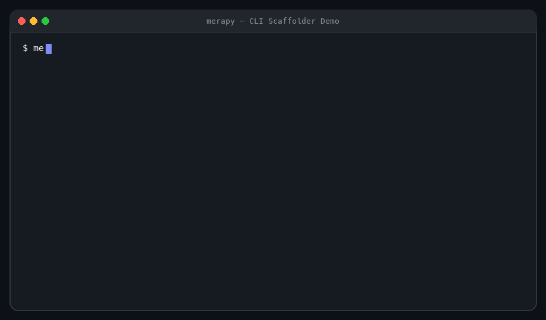
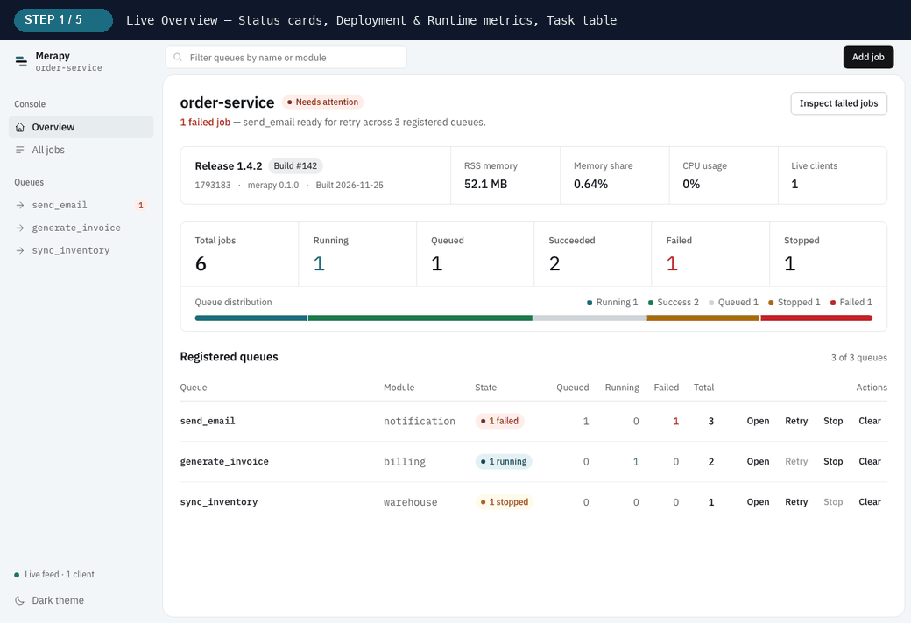
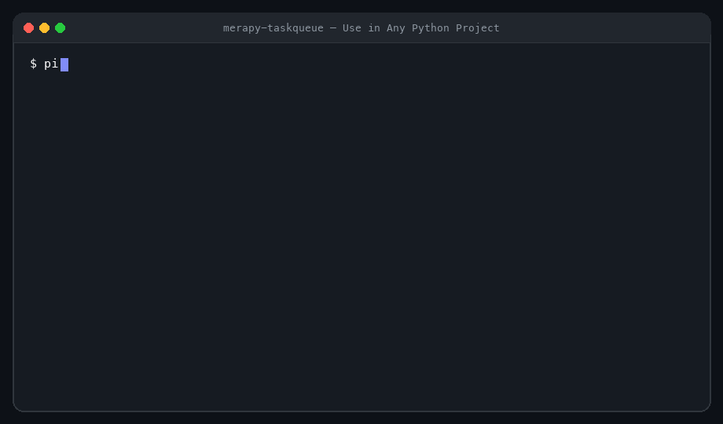

# merapy

**merapy** is a Python 3.11+ clean-architecture microservice framework inspired by Go's [candi](https://github.com/golangid/candi). Build REST, gRPC, GraphQL, and background worker services around one shared domain core — complete with an interactive scaffolder CLI, standalone release binaries, and a fast real-time Task Queue dashboard.



---

## Highlights

- **One service, many transports** — REST (FastAPI or Litestar), gRPC, GraphQL (Strawberry), and 6 workers (Kafka, RabbitMQ, Redis Pub/Sub, Cron Scheduler, Postgres `LISTEN`, and persistent Task Queue) orchestrated under one `asyncio` lifecycle with graceful shutdown.
- **Clean architecture out of the box** — `delivery → usecase → repository → DB` with thread-safe singletons and `# @merapy:*` markers so `merapy add-module` and `merapy add-handler` wire everything automatically.
- **Standalone CLI binary** — download a single 9 MB binary for macOS, Linux, or Windows from [GitHub Releases](https://github.com/dimassantoso/merapy/releases) — no Python environment required just to scaffold projects.
- **Ultra-fast embedded Task Queue dashboard** — rebuilt on **Vite + Preact** (~23 KB gzipped, <300 ms build) with the Framed Sheet observability design system, live GraphQL WebSocket subscriptions, and automatic same-origin detection.
- **Reusable standalone Task Queue package** — install `merapy-taskqueue` independently in *any* Python app (FastAPI, Starlette, Django, or plain `asyncio`) with pluggable Memory, SQL, MongoDB, or Redis storage.

> **New here?** Follow the hands-on **[Step-by-Step Tutorial](docs/TUTORIAL.md)** with visual walkthroughs.

---

## Installation

### Option 1 — Standalone CLI Binary (no Python needed to scaffold)

Download the binary for your OS from the [Releases](https://github.com/dimassantoso/merapy/releases) page:

```bash
# macOS (Apple Silicon)
chmod +x merapy-macos-arm64
sudo mv merapy-macos-arm64 /usr/local/bin/merapy
merapy --version
```

### Option 2 — Install with `pipx` or `uv`

```bash
# pipx
pipx install git+https://github.com/dimassantoso/merapy.git

# uv
uv tool install git+https://github.com/dimassantoso/merapy.git
```

### Option 3 — Local Development Clone

```bash
git clone https://github.com/dimassantoso/merapy.git
cd merapy
python3.12 -m venv .venv
make dev
```

---

## 60-Second Quickstart

```bash
# 1. Scaffold a service interactively
merapy init

# 2. Enter the project and install dependencies
cd order-service
python3.12 -m venv .venv
source .venv/bin/activate
pip install -e ".[dev]"

# 3. Create your database and apply migrations
createdb order_service
make migration-create name=init
make migration

# 4. Run the service
make run
```

Default endpoints once running:

| Transport | URL |
|---|---|
| REST API | `http://localhost:8000/v1/<module>/` |
| GraphQL API | `http://localhost:8100/graphql` |
| Task Queue Dashboard | `http://localhost:8080/` |

Switch REST framework anytime without changing handler code:

```bash
REST_FRAMEWORK=litestar make run
```

---

## Real-Time Task Queue Dashboard

Enable `USE_TASK_QUEUE_WORKER=true` and open `http://localhost:8080`. The embedded **Vite + Preact + Tailwind CSS v4** dashboard gives you live job counts, deployment/runtime metrics, job filtering, payload/error inspection, and one-click Retry, Stop, Delete, and Clear actions over GraphQL WebSocket subscriptions.



---

## Use the Task Queue in *Any* Python Project (`merapy-taskqueue`)

You do not need the full `merapy` microservice framework to use the Task Queue and its live dashboard. The extracted standalone package lives in [`packages/merapy-taskqueue`](packages/merapy-taskqueue/README.md) and supports **In-Memory**, **SQLAlchemy**, **MongoDB**, and **Redis** backends out of the box.



```python
import asyncio
from merapy_taskqueue import MemoryJobStore, TaskContext, TaskQueue

tq = TaskQueue(store=MemoryJobStore(), dashboard_port=8080, service_name="billing-app")

@tq.task("send_email")
async def send_email(ctx: TaskContext) -> dict[str, bool]:
    print("Processing:", ctx.job_id, ctx.arguments)
    return {"sent": True}

async def main() -> None:
    await tq.enqueue("send_email", {"to": "alice@example.com"})
    await tq.serve()  # runs worker + live dashboard at http://localhost:8080

asyncio.run(main())
```

See [`packages/merapy-taskqueue/README.md`](packages/merapy-taskqueue/README.md) for SQL, MongoDB, Redis, and FastAPI mounting examples.

---

## CLI Reference

Running `merapy` with no arguments opens the interactive menu.

| Command | Description |
|---|---|
| `merapy init` | Interactive wizard to scaffold a complete service (modules, servers, workers, datastores). |
| `merapy add-module <name>` | Adds a domain module and injects `# @merapy:*` markers into shared UOW and GraphQL files. |
| `merapy add-handler <module> <type>` | Adds a delivery handler (`rest`, `grpc`, `graphql`, `kafka`, `cron`, `redis`, `rabbitmq`, `postgres`, `task_queue`). |
| `merapy --version` | Prints the installed CLI version. |

---

## Generated Service Architecture

```text
main.py
  └─ check_pending_migrations() → App(service).run()
       └─ ServiceFactory
            ├─ Dependency singleton (SQL, Mongo, Redis, Brokers, Middleware, Validator)
            ├─ SharedRepository & SharedUsecase UOW (cross-module bridge)
            └─ modules/<name>/
                 ├── delivery/    (REST, gRPC, GraphQL, Kafka, Cron, Redis, RabbitMQ, Postgres, Task Queue)
                 ├── usecase/     (business logic)
                 ├── repository/  (SQLAlchemy async data access)
                 └── domain/      (Pydantic DTOs)
```

---

## Key Environment Variables

| Variable | Default | Purpose |
|---|---|---|
| `SERVICE_NAME` | `merapy-service` | Service title displayed in logs and dashboard navbar |
| `REST_FRAMEWORK` | `fastapi` | REST adapter (`fastapi` or `litestar`) |
| `HTTP_PORT` / `GRPC_PORT` | `8000` / `8002` | Server listen ports |
| `USE_REST` / `USE_GRPC` / `USE_GRAPHQL` | `true` / `false` / `false` | Enable server transports |
| `USE_TASK_QUEUE_WORKER` | `false` | Enable task queue worker + embedded dashboard |
| `TASK_QUEUE_DASHBOARD_PORT` | `8080` | Dashboard HTTP & WebSocket port |
| `MAX_WORKERS` | `10` | Per-worker concurrency cap (`asyncio.Semaphore`) |
| `APP_VERSION`, `BUILD_NUMBER`, `GIT_COMMIT`, `BUILD_DATE` | `dev`, `""` | Deployment metadata shown in dashboard |

---

## Ecosystem

| Package / Repo | Purpose |
|---|---|
| [`merapy`](https://github.com/dimassantoso/merapy) | Core microservice framework + standalone CLI |
| [`packages/merapy-taskqueue`](packages/merapy-taskqueue/README.md) | Standalone async Task Queue + embedded Vite/Preact dashboard |
| [`merapy-plugin`](https://github.com/dimassantoso/merapy-plugin) | Optional adapters (AWS SQS/SNS, GCP Pub/Sub, STOMP, OracleDB, ArangoDB, Sanic, BlackSheep, P2P, Circuit Breaker, OTLP Tracer) |

---

## Development & Building Releases

```bash
make dev           # install merapy + merapy-taskqueue editable
make test          # run all unit tests (merapy + merapy-taskqueue)
make lint          # ruff check
make typecheck     # mypy strict check
make ui-build      # rebuild Vite + Preact dashboard and embed static files
make release       # build standalone CLI binary + Python wheels/sdists + SHA256SUMS into release/
```

Push a `v*` tag (for example `git tag v0.1.0 && git push origin v0.1.0`) to build Linux, macOS, and Windows binaries automatically via [`.github/workflows/release.yml`](.github/workflows/release.yml).

---

## License

MIT — see [`LICENSE`](LICENSE).
