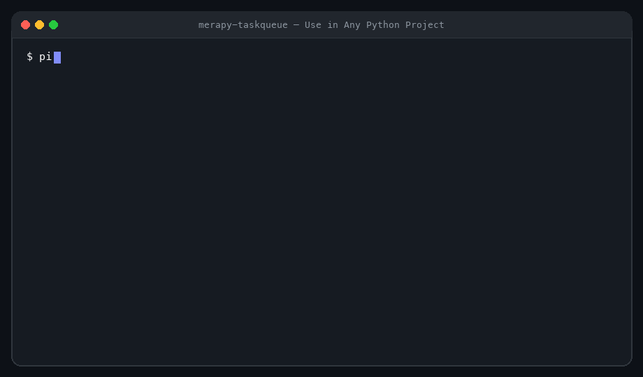
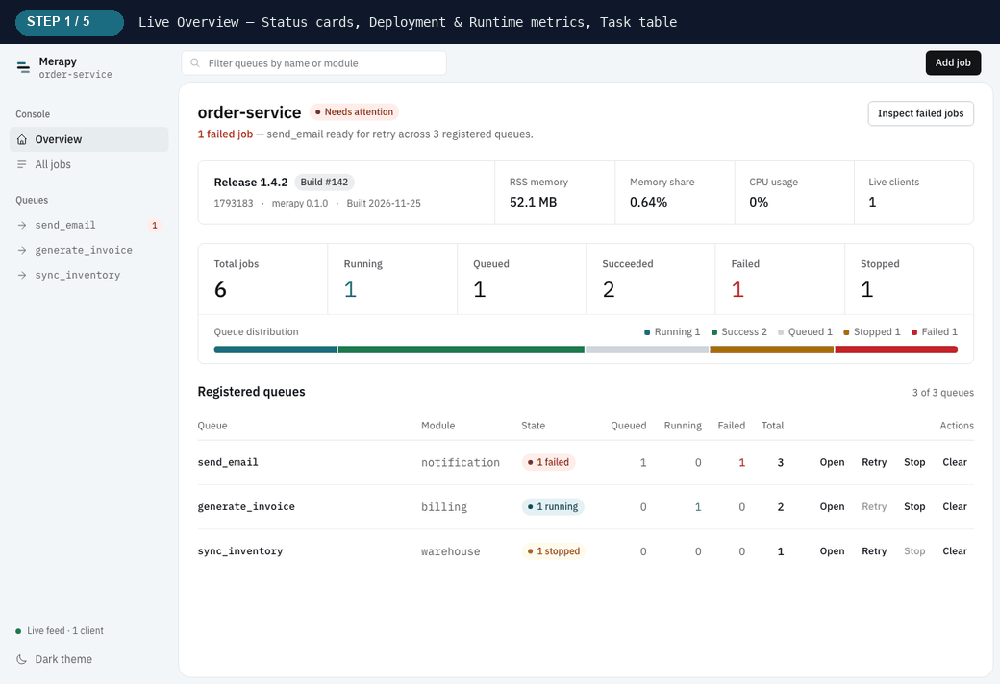

# merapy-taskqueue

Standalone async Python task queue with pluggable storage backends (**In-Memory**, **SQLAlchemy**, **MongoDB**, **Redis**) and an embedded real-time GraphQL dashboard built with **Vite + Preact** (~23 KB gzipped).

Use it in **any** Python project (FastAPI, Starlette, Django, or plain `asyncio`) without installing the full `merapy` microservice framework.



---

## Live Dashboard



- Real-time task & job updates over GraphQL WebSocket subscriptions (with automatic HTTP polling fallback).
- Same-origin auto-detection — works on any port, domain, or HTTPS reverse proxy without rebuilding.
- One-click **Add Job**, **Retry**, **Retry All**, **Stop**, **Stop All**, **Delete**, and **Clear**.

---

## Install

```bash
pip install merapy-taskqueue          # core + MemoryJobStore + embedded dashboard
pip install "merapy-taskqueue[sql]"   # + SQLAlchemy 2.x async store
pip install "merapy-taskqueue[mongo]" # + MongoDB (Motor) store
pip install "merapy-taskqueue[redis]" # + Redis async store
pip install "merapy-taskqueue[all]"   # all stores + psutil process metrics
```

---

## Quickstart

```python
import asyncio
from merapy_taskqueue import MemoryJobStore, TaskContext, TaskQueue

tq = TaskQueue(store=MemoryJobStore(), dashboard_port=8080, service_name="billing-app")

@tq.task("send_email")
async def send_email(ctx: TaskContext) -> dict[str, bool]:
    print("Processing job:", ctx.job_id, ctx.arguments)
    return {"sent": True}

async def main() -> None:
    await tq.enqueue("send_email", {"to": "alice@example.com"})
    await tq.serve()  # worker loop + dashboard at http://localhost:8080

asyncio.run(main())
```

### Pluggable Backends

| Backend | Class | Notes |
|---|---|---|
| In-Memory | `MemoryJobStore()` | Zero external deps — ideal for scripts, dev, and tests |
| SQL (Postgres/MySQL/SQLite) | `SQLJobStore(async_session_factory)` | Uses `TaskQueueBase` 4-table schema (candi-compatible) |
| MongoDB | `MongoJobStore(motor_db)` | Full dashboard query & mutation support |
| Redis | `RedisJobStore(async_redis)` | Full dashboard query & mutation support |

### Mount Inside an Existing FastAPI App

```python
from fastapi import FastAPI
from merapy_taskqueue import MemoryJobStore, TaskQueue

app = FastAPI()
tq = TaskQueue(store=MemoryJobStore(), dashboard_enabled=False)

@tq.task("resize_image")
async def resize_image(ctx):
    ...

app.mount("/tasks", tq.dashboard_app())
```

---

## Rebuilding the Embedded UI

```bash
cd ui
npm install
npm run build   # compiles directly into src/merapy_taskqueue/dashboard_static/
```
